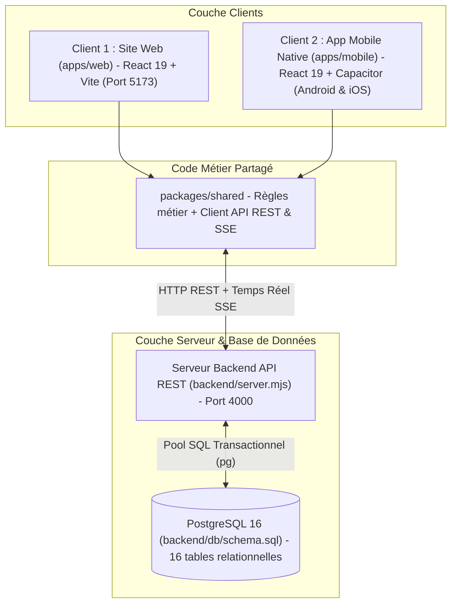

# Documentation Complète du Projet SAVAA (Architecture, Fonctionnalités, Diffs & Mises à Jour)

**Plateforme Agropastorale de Confiance en Côte d'Ivoire — Marché, Traçabilité, Logistique, Santé Animale & Investissement**

---

## 1. Présentation Générale

**SAVAA** est une plateforme numérique agropastorale conçue pour connecter et sécuriser l'ensemble des acteurs des filières d'élevage et d'agriculture en Côte d'Ivoire (région des Savanes / Korhogo et ensemble des 33 régions et districts autonomes).

Elle repose sur **5 piliers métier** :
1. **Marché & Commerce (B2C / B2B)** : achat et vente d'animaux vivants, récoltes, volailles, intrants, matériel et services, avec tarifs grand public, négociation par messagerie, paiement intégral ou acompte séquestre (20 %), et **prix professionnels** réservés aux restaurants et hôtels vérifiés (RCCM).
2. **Traçabilité & Fiches d'Identité (`SAV-TRACE`)** : chaque produit ou animal publié dispose d'une fiche d'identité et d'un QR code unique (`SAV-TRACE-2026-XXXXXX`) consultable publiquement ou par scanner caméra, avec 4 niveaux de preuve (*Déclaré*, *Documenté*, *Vérifié*, *Certifié*).
3. **Suivi de Cheptel & Santé Vétérinaire** : gestion du troupeau (bovins, ovins, caprins), pesées, généalogie, carnet sanitaire, alertes sanitaires envoyées aux vétérinaires, demandes de visites et validation officielle des fiches animales.
4. **Logistique & Livraison Intelligente** : calcul automatique de la charge (kg, têtes, produits frais), de la distance routière entre localités, sélection du véhicule adapté (moto, tricycle, pick-up, bétaillère, camion, frigorifique, groupage), carte interactive OpenStreetMap/Leaflet et remise sécurisée par code à 4 chiffres.
5. **Espace Investisseur & Projets Agricoles** : constitution de dossiers d'investissement (particuliers et entreprises) en plusieurs étapes, analyse KYC et algorithme de rapprochement sur 100 points dans le Back-Office, catalogue de projets agricoles et propositions personnalisées.

---

## 2. Architecture Technique (Modèle Client-Serveur façon Jumia)

Le système sépare strictement **les deux clients** (le **Site Web** et l'**Application Mobile Native**) qui partagent **la même API Backend et la même base de données PostgreSQL** :



### Répartition entre le Site Web et l'Application Mobile
- **Client 1 — Site Web (`apps/web/`)** :
  - Destiné aux ordinateurs, tablettes et navigateurs web.
  - Intègre la barre de navigation grand écran (`DesktopNav`), l'accueil e-commerce multi-colonnes, les fiches de traçabilité publiques ouvertes par scan QR sans application installée (`/#/fiche/SAV-TRACE-...`), les espaces professionnels sur ordinateur (Investisseurs, Fournisseurs B2B, Restaurants, Vendeurs) et **le Back-Office interne d'administration (`/#/admin`)**.
- **Client 2 — Application Mobile Native (`apps/mobile/` + `android/` & `ios/`)** :
  - Aucune PWA (Service Worker `sw.js` et `manifest.webmanifest` supprimés).
  - Empaquetée nativement via **Capacitor** (`ci.savaa.app`) pour Google Play Store (`.apk` / `.aab`) et Apple App Store (`.ipa`).
  - Interface 100 % mobile avec barre d'onglets inférieure (`TabBar`), en-tête mobile (`Header`) et accès natif à la caméra (scanner QR `SAV-TRACE` et prise de photos sur le terrain).
  - **N'embarque jamais le Back-Office `/admin`** ni la barre bureau `DesktopNav`.
- **Serveur Central (`backend/`) + PostgreSQL** :
  - Toute action effectuée sur l'Application Mobile (publication d'annonce, commande, alerte sanitaire, mission livreur, demande de devis, inscription) est enregistrée dans **PostgreSQL** et répercutée en temps réel sur le Site Web et dans le Back-Office `/admin` (et inversement).

---

## 3. Cartographie Complète des Fichiers du Projet

```text
savaa-react/
├── apps/
│   ├── web/                        # Client 1 : Site Web + Back-Office (/admin)
│   │   ├── src/main.tsx            # Point d'entrée Web (<App target="web" />)
│   │   ├── index.html              # Page HTML du Site Web
│   │   ├── vite.config.ts          # Configuration Vite Web (port 5173 → apps/web/dist)
│   │   └── package.json
│   │
│   └── mobile/                     # Client 2 : Application Mobile Native (sans /admin)
│       ├── src/main.tsx            # Point d'entrée Mobile (<App target="mobile" />)
│       ├── index.html              # Page HTML Mobile (viewport-fit=cover)
│       ├── vite.config.ts          # Configuration Vite Mobile (port 5174 → apps/mobile/dist)
│       └── package.json
│
├── packages/
│   └── shared/                     # Librairie commune aux 2 clients
│       ├── api.ts                  # Client HTTP REST + Synchronisation temps réel SSE
│       ├── index.ts                # Export des modules métier partagés
│       └── package.json
│
├── backend/                        # Serveur API REST central + PostgreSQL
│   ├── db/
│   │   ├── schema.sql              # Schéma relationnel PostgreSQL (16 tables + index)
│   │   ├── postgres.mjs            # Pool PostgreSQL (pg) et transactions SQL
│   │   └── migrate.mjs             # Script d'initialisation / migration PostgreSQL
│   ├── server.mjs                  # Serveur HTTP REST & SSE (port 4000)
│   ├── .env.example                # Exemple de configuration PostgreSQL (DATABASE_URL)
│   └── package.json
│
├── android/                        # Projet natif Android (Android Studio / Gradle / Permissions Caméra)
├── ios/                            # Projet natif iOS (Xcode / Info.plist Caméra & Photos en français)
├── capacitor.config.ts             # Configuration Capacitor (ci.savaa.app → apps/mobile/dist)
├── docker-compose.yml              # Conteneur PostgreSQL 16 préconfiguré avec schema.sql
│
├── src/                            # Cœur applicatif React & Logique Métier
│   ├── screens/                    # Tous les écrans de la plateforme (chargés en React.lazy)
│   │   ├── achat.tsx               # Accueil marchand, catalogue, fiche annonce, avis, boutique publique
│   │   ├── commande.tsx            # Panier, paiement Mobile Money (100 % ou acompte 20 %), reçu, suivi, assistance
│   │   ├── compte.tsx              # Démarrage, connexion OTP SMS, choix intention/rôle, profil métier, notifications
│   │   ├── eleveur.tsx             # Tableau de bord éleveur, cheptel, ajout d'animal, échéances (.ics)
│   │   ├── sante.tsx               # Fiche animale (5 onglets + QR + vérification véto), dossier sanitaire, observation
│   │   ├── fiche.tsx               # Fiche produit publique (/fiche/:code), frise de traçabilité & fenêtre QR code
│   │   ├── scanner.tsx             # Scanner QR code caméra (BarcodeDetector) + saisie manuelle
│   │   ├── vente.tsx               # Boutique vendeur, publication en 4 étapes, campagnes, espace restaurant
│   │   ├── tableaux.tsx            # Tableau de bord vendeur (/vendeur)
│   │   ├── metiers.tsx             # Espaces Vétérinaire (/veto), Transporteur (/missions), Producteur (/recoltes), Fournisseur (/fournisseur)
│   │   ├── devis.tsx               # Demandes et offres de devis B2B (/devis)
│   │   ├── messages.tsx            # Messagerie interne avec négociation d'offres de prix, photos et notes vocales
│   │   ├── investir.tsx            # Espace investisseur (/investir, dossier en étapes, propositions)
│   │   ├── crm.tsx                 # Back-office équipe SAVAA (/admin : modération, KYC, prospection, stats)
│   │   └── admin-invest.tsx        # Back-office Investisseurs (graphiques, scoring) & Catalogue de Projets agricoles
│   │
│   ├── api.ts                      # Pont vers packages/shared/api.ts
│   ├── data.ts                     # Store réactif + synchronisation avec le serveur PostgreSQL
│   ├── data.test.ts                # Tests unitaires messagerie, offres, avis, panier, acompte, commandes
│   ├── trace.ts                    # Système de traçabilité SAV-TRACE (9 catégories, niveaux de preuve)
│   ├── trace.test.ts               # 22 tests unitaires sur la traçabilité et les statuts animaux
│   ├── livraison.ts                # Moteur logistique (7 véhicules, distances, tarifs, commission 5 %)
│   ├── livraison.test.ts           # 14 tests unitaires sur les charges, distances et tarifs de livraison
│   ├── carte.tsx                   # Carte interactive OpenStreetMap / Leaflet (zone livreur, mission, suivi)
│   ├── invest.ts                   # Modèle et validation des dossiers investisseurs (particulier / entreprise)
│   ├── invest.test.ts              # 12 tests unitaires sur les étapes, erreurs et complétude du dossier
│   ├── invest-admin.ts             # Algorithme de rapprochement investisseur/projet (score sur 100)
│   ├── invest-admin.test.ts        # 6 tests unitaires sur le scoring de rapprochement
│   ├── profils.ts                  # Champs et pièces justificatives par métier à l'inscription
│   ├── profils.test.ts             # 7 tests unitaires sur les règles de cumul de métiers et justificatifs
│   ├── phone.ts                    # Normalisation et validation des numéros ivoiriens à 10 chiffres (+225)
│   ├── phone.test.ts               # 6 tests unitaires sur les numéros de téléphone
│   ├── agri.ts                     # Calendrier cultural et calcul des volumes producteurs agricoles
│   ├── agri.test.ts                # 4 tests unitaires sur les lots et volumes agricoles
│   ├── scanner-code.ts             # Décodage d'un QR code ou texte vers /fiche/:code ou /animal/:id
│   ├── scanner-code.test.ts        # 4 tests unitaires du décodeur QR
│   ├── hooks.ts                    # Hooks React partagés (useOnline, useNavTabs) extraits pour Fast Refresh
│   ├── dash.tsx                    # Composants des tableaux de bord métiers (DashHeader, TodayCard, Kpis, ProjectPhoto)
│   ├── guard.tsx                   # Contrôle d'accès par rôle (Guard) et code équipe SAVAA-EQUIPE (StaffGuard)
│   ├── nav.tsx                     # Barre de navigation grand écran du Site Web (DesktopNav)
│   ├── logo.tsx                    # Logo vectoriel SAVAA avec animations CSS (« Récolte & Marché »)
│   ├── relief.tsx & relief-icons.ts# Icônes illustrées en relief pour les catégories et filières
│   ├── photos.ts                   # Association des libellés maquette aux 32 photos de public/images/
│   ├── device.ts                   # Compression photo JPEG 640px, partage natif, exports CSV / .ics, impression PDF
│   ├── toast.ts                    # Notifications éphémères en bas d'écran
│   └── ui.tsx                      # Design System SAVAA (Header, TabBar, Badge, Icon, Section, OfflineBanner, Toaster)
```

---

## 4. Historique Complet des Ajouts, Diffs & Mises à Jour (De l'Origine à Aujourd'hui)

### Phase 1 (19/11/2026) — Fondation & Intégration des 30 Écrans de la Maquette v2
- **Commit `b6cfbb1` — Front SAVAA : lots 1 à 6 (`56 fichiers, +10 018 lignes`)** :
  - Intégration initiale de tous les écrans de la maquette HTML (`maquette/02-Accueil.dc.html` à `27-Design-system.dc.html`) en composants React : `achat.tsx`, `commande.tsx`, `compte.tsx`, `crm.tsx`, `eleveur.tsx`, `sante.tsx`, `vente.tsx`.
  - Mise en place de la feuille de style `src/index.css` fidèle à la charte (`#145C3A`, `#E8F3EA`, `#F28C28`, `#F8FAF8`, police `IBM Plex Sans`).
- **Commits `296926c`, `3fd7256`, `66479d2`, `261b9f6`, `13d3c98`, `0176eb7` (`+320 / -187 lignes`)** :
  - **Ajouts** : composant `NotFound` pour toute URL avec identifiant inconnu (`/animal/:id`, `/annonce/:id`, `/prospect/:id`), système de messages éphémères `src/toast.ts` (`<Toaster />`), rattachement des événements sanitaires par `animalId` (`store.eventsFor(id)`), création réelle de prospects à l'écran `16c`, correction du rétrécissement vertical (`flex-shrink: 0` sur `.body>*` pour les écrans `< 844 px`).

### Phase 2 (19/11/2026) — Front Fonctionnel de Bout en Bout & Comptes par Rôle
- **Commits `4ff1837`, `5c1f079`, `aef61f0`, `99c4cb7` (`+1 414 / -436 lignes`)** :
  - **Ajouts** : `src/device.ts` (compression photo en JPEG 640 px avant stockage, partage natif `navigator.share`, export CSV compatible Excel FR, export calendrier `.ics`, impression PDF), `src/photos.ts` + 32 photos réelles dans `public/images/`.
  - **Fonctionnalités rendues dynamiques** : panier multi-articles, paiement simulé avec compte à rebours, génération de commande et reçu imprimable, publication d'annonce avec photos de l'appareil et brouillon, création de boutique, tickets d'assistance avec photos, modération des annonces dans le back-office, notifications dynamiques non lues.
- **Commits `0b2878f`, `cf9d5fd` à `e922d0a` (`+2 287 / -568 lignes`)** :
  - **Ajouts** : `src/guard.tsx` (`Guard` par rôle), séparation stricte entre un **nouveau compte** (qui part de zéro, formulaires et cheptel vides) et le **compte de démonstration** (Adama Koné, Ferme Koné & Fils, 46 têtes).
  - **Mises à jour UI** : bannière d'annonces sponsorisées défilante sur l'accueil acheteur, onglets `/favoris` et `/commandes`, grille à 2 colonnes, back-office responsive sur mobile et tablette (tableaux transformés en fiches sans défilement horizontal, menu burger), prospection intégrée comme rubrique du back-office.

### Phase 3 (19–20/11/2026) — 8 Espaces Métiers Dédiés, Logo Animé, Paiements & `StaffGuard`
- **Commits `3f1253c`, `f5e4949`, `1bf71af`, `292214d` (`+1 297 / -275 lignes`)** :
  - **Ajouts** :
    - `src/screens/metiers.tsx` (`+656 lignes`) : création des 4 espaces métiers spécialisés Vétérinaire (`/veto`), Transporteur (`/missions`), Producteur agricole (`/recoltes`) et Fournisseur B2B (`/fournisseur`).
    - `src/logo.tsx` & `public/logo-savaa.svg` : nouveau logo vectoriel SAVAA avec animation CSS « Récolte & Marché » au démarrage et déclinaison blanche dans les en-têtes.
    - `public/images/payments/` : logos officiels Orange Money, MTN MoMo, Moov Money, Wave, Mastercard, paiement à la livraison et virement.
    - `StaffGuard` dans `src/guard.tsx` : protection du back-office `/#/admin` par le code d'équipe `SAVAA-EQUIPE`.
    - `CI_REGIONS` dans `src/data.ts` : districts et villes de toute la Côte d'Ivoire.

### Phase 4 (20/11/2026) — Traçabilité `SAV-TRACE` (Axes 1, 2, 3), Tableaux de Bord & Profils Métiers
- **Commit `b456610` — Fiches d'identité et de traçabilité `SAV-TRACE` (`13 fichiers, +1 219 / -145 lignes`)** :
  - **Ajouts** :
    - `src/trace.ts` (`+207 lignes`) : 8 catégories du cahier des charges, génération de code unique `SAV-TRACE-2026-XXXXXX`, statuts de fiche, déduction automatique du statut d'un animal (`animalStatus`).
    - `src/screens/fiche.tsx` (`+205 lignes`) : fiche produit publique `/fiche/:code` (sections repliables Produit, Vendeur, Origine, Prix et vente, frise de traçabilité avec les 4 niveaux de preuve et fenêtre QR code `QrDialog` via `react-qr-code`).
  - **Modifications** :
    - `src/screens/vente.tsx` (`Publish`) : réécriture complète de la publication d'annonce en **4 étapes** (Produit, Origine, Prix et vente, Vendeur) + contrôle des champs obligatoires + aperçu avant envoi en modération.
    - `src/screens/sante.tsx` & `src/screens/eleveur.tsx` : ajout de la pesée, mensurations, état général, vocation, origine complète, historique de traçabilité unifié et QR code sur la fiche animale.
- **Commits `0fccf2d`, `1b610c6` — Tableaux de bord métiers & Profil métier KYC (`15 fichiers, +864 / -142 lignes`)** :
  - **Ajouts** :
    - `src/dash.tsx` (`DashHeader`, `TodayCard`, `Kpis`, `QuickActions`, `Avatar`).
    - `src/screens/tableaux.tsx` : tableau de bord vendeur (`/vendeur`).
    - `src/profils.ts` : définition des champs et justificatifs photo obligatoires par métier à l'écran `/profil-metier` (étape 3 de l'inscription).
    - 9e catégorie de traçabilité dans `src/trace.ts` : **« Engrais et produits phytosanitaires »** (fabricant, matière active, n° d'homologation, lot, péremption).

### Phase 5 (21/11/2026) — Espace Investisseur, Prix Pro B2B, Connexion SMS & Interface Web Bureau
- **Commit `f4b6b3a` — Espace investisseur, inscription par intention, prix pro, tests Vitest (`22 fichiers, +2 759 / -74 lignes`)** :
  - **Ajouts** :
    - `src/invest.ts` (`+314 lignes`) & `src/screens/investir.tsx` (`+550 lignes`) : tableau de bord `/investir`, formulaire de dossier particulier ou entreprise en étapes (`/investir/dossier`) avec sauvegarde auto, contrôle de majorité (18 ans), consentement ARTCI (loi 2013-450), référence `INV-2026-XXXXXX`, et catalogue de propositions (`/investir/propositions/:id`).
    - `src/invest-admin.ts` (`+189 lignes`) & `src/screens/admin-invest.tsx` (`+523 lignes`) : rubriques Back-Office **Investisseurs** (contrôle KYC, décisions horodatées, notes internes, algorithme de rapprochement `matchProject` noté sur 100, envoi de propositions) et **Projets agricoles** (création, publication, archivage avec photo).
    - **Inscription par intention** (4 cartes : *Acheter*, *Vendre*, *Proposer un service*, *Investir*) et **Prix Pro** (`proPrice`, `store.priceFor`) réservé aux restaurants/hôtels ayant renseigné leur RCCM.
    - Mise en place des **tests unitaires Vitest** (`trace.test.ts`, `profils.test.ts`, `invest.test.ts`, `invest-admin.test.ts`).
- **Commits `c913527`, `fe417c2`, `a3a0774`, `f90238b`, `9d91c58`, `66b76e9` (`+857 / -357 lignes`)** :
  - **Ajouts** :
    - `src/phone.ts` & `src/phone.test.ts` : validation des numéros ivoiriens à 10 chiffres (retrait automatique de `+225`), connexion SMS en 3 temps, sauvegarde multi-comptes par numéro (`savaa-comptes-v1`) et reprise d'inscription en cours (`onboarding`).
    - `src/nav.tsx` (`DesktopNav`) & règles `@media (min-width: 640px)` / `@media (min-width: 1024px)` dans `src/index.css` : barre de navigation supérieure pour ordinateur, grilles fluides multi-colonnes et fiche produit en 2 colonnes.

### Phase 6 (22/11/2026) — Liaisons Inter-Rôles, Livraison Intelligente, Carte Leaflet & Devis/Factures
- **Commits `87b98f8`, `7d02f44` (`32 fichiers, +2 272 / -327 lignes`)** :
  - **Ajouts** :
    - `src/livraison.ts` (`+156 lignes`) & `src/livraison.test.ts` (`+82 lignes`) : moteur de calcul logistique (conversion du panier en charge `kg`/têtes/frais, calcul de distance routière entre villes connues, sélection parmi 7 véhicules, tarification détaillée + commission SAVAA de 5 %).
    - `src/carte.tsx` (`+68 lignes`) : carte interactive OpenStreetMap / Leaflet affichant la zone de couverture du livreur, le trajet d'enlèvement → livraison et le suivi acheteur.
    - `src/screens/devis.tsx` (`+210 lignes`) : demandes de devis B2B (`/devis`), réponses des fournisseurs, acceptation d'offre, émission et paiement de factures à 15 jours, transformation en commandes récurrentes.
    - `src/agri.ts`, `src/agri.test.ts`, `src/relief.tsx`, `src/relief-icons.ts` : calendrier cultural, volumes agricoles, icônes en relief et 3 graphiques analytiques dans le back-office investisseurs.
    - Découpage du chargement des écrans avec `React.lazy` et `Suspense` dans `src/App.tsx`.

### Phase 7 (27/11/2026) — Messagerie Interne, Scanner QR, Boutique Publique, Acompte Séquestre & 85 Tests
- **Commits `c30d0b9`, `a11536c`, `3db267d` (`33 fichiers, +3 694 / -557 lignes`)** :
  - **Ajouts** :
    - `src/screens/messages.tsx` (`+521 lignes`) : messagerie interne temps réel entre acheteurs, vendeurs et livreurs, avec envoi de photos, enregistrement de **notes vocales au micro** et **offres de prix négociées** (accepter une offre applique automatiquement le prix négocié `agreedPrice` au panier).
    - `src/screens/scanner.tsx` (`+201 lignes`), `src/scanner-code.ts` & `src/scanner-code.test.ts` : scanner QR code utilisant la caméra (`BarcodeDetector`) avec repli de saisie manuelle pour ouvrir instantanément `/fiche/SAV-TRACE-...` ou `/animal/FK-...`.
    - **Boutique publique** (`/boutique-publique/:seller` dans `src/screens/achat.tsx`) et système d'**avis clients vérifiés** (notes sur 5 étoiles + droit de réponse du vendeur).
    - **Paiement séquestre par acompte de 20 %** (`paymentMode: 'deposit'`) au panier et au paiement Mobile Money, avec calcul du solde à régler à la remise et annulation de commande avant prise en charge.
    - `src/hooks.ts` (`+65 lignes`) & `src/data.test.ts` (`+230 lignes`) : extraction des hooks React pour supprimer tous les warnings ESLint et passage de la suite de tests à **85 tests unitaires Vitest (9 fichiers de test)**.

### Phase 8 (27/11/2026) — Suppression PWA, Packaging Mobile Natif (Capacitor), Séparation Client-Serveur (`apps/web` & `apps/mobile`) et Base PostgreSQL
- **Diffs & Modifications réalisés lors de cette phase** :
  1. **Suppression complète de la PWA** :
     - `D public/sw.js` *(supprimé)* : retrait du Service Worker de cache PWA.
     - `D public/manifest.webmanifest` *(supprimé)* : retrait du manifeste d'installation web.
     - `M src/main.tsx` (`-9 lignes`) : suppression de `navigator.serviceWorker.register('./sw.js')`.
     - `M index.html` (`-7 lignes`) : retrait des balises `manifest` et `apple-mobile-web-app-capable`.
  2. **Séparation en 2 Clients distincts (`apps/web` et `apps/mobile`) + Code Partagé (`packages/shared`)** :
     - `A apps/web/package.json`, `A apps/web/index.html`, `A apps/web/vite.config.ts`, `A apps/web/src/main.tsx` : Client 1 (Site Web sur port `5173`, build dans `apps/web/dist`), incluant `DesktopNav` et le Back-Office `/admin`.
     - `A apps/mobile/package.json`, `A apps/mobile/index.html`, `A apps/mobile/vite.config.ts`, `A apps/mobile/src/main.tsx` : Client 2 (Application Mobile sur port `5174`, build dans `apps/mobile/dist`), **sans `DesktopNav` et sans la route `/admin`**.
     - `M src/App.tsx` (`+19 / -8 lignes`) : ajout du paramètre `target?: 'web' | 'mobile'` (`VITE_APP_TARGET`) qui exclut `DesktopNav` et les routes `/admin`, `/prospection`, `/prospect/:id` du build mobile.
     - `A packages/shared/package.json`, `A packages/shared/api.ts`, `A packages/shared/index.ts` & `A src/api.ts` : client API HTTP REST + écoute temps réel SSE (`EventSource`) et ré-export des modules métier partagés.
     - `M src/data.ts` (`+38 lignes`) : branchement de `writeNet`, `writeAccounts`, `store.put`, `store.reset` et `syncWithBackend()` sur le serveur API REST.
  3. **Empaquetage Mobile Natif Android & iOS (Capacitor)** :
     - `A capacitor.config.ts` : configuration native `ci.savaa.app` pointant sur `webDir: 'apps/mobile/dist'`.
     - `A android/` : projet natif Android Studio / Gradle complet, avec ajout de la permission caméra (`android.permission.CAMERA`) dans `android/app/src/main/AndroidManifest.xml` et des couleurs SAVAA (`#145C3A`, `#F28C28`) dans `android/app/src/main/res/values/colors.xml`.
     - `A ios/` : projet natif Xcode complet, avec descriptions en français `NSCameraUsageDescription` et `NSPhotoLibraryUsageDescription` dans `ios/App/App/Info.plist`.
  4. **Serveur Backend API REST & Base de Données Relationnelle PostgreSQL (`backend/`)** :
     - `A backend/db/schema.sql` (`+178 lignes`) : création des **16 tables PostgreSQL** (`savaa_meta`, `savaa_accounts`, `savaa_listings`, `savaa_alerts`, `savaa_missions`, `savaa_quotes`, `savaa_sales`, `savaa_validations`, `savaa_invoices`, `savaa_recurring`, `savaa_visits`, `savaa_kyc`, `savaa_couriers`, `savaa_threads`, `savaa_reviews`, `savaa_kv`) et de leurs index SQL.
     - `A backend/db/postgres.mjs` (`+340 lignes`) : pool de connexion `pg` (`DATABASE_URL`), transactions SQL (`BEGIN` / `COMMIT` / `ROLLBACK`), lecture/écriture relationnelle et remise à zéro (`TRUNCATE`).
     - `A backend/db/migrate.mjs` : script CLI (`npm run db:migrate`) appliquant `schema.sql`.
     - `A backend/server.mjs` (`+212 lignes`) & `A backend/package.json` : serveur REST Node.js (`GET /api/health`, `GET /api/sync`, `PUT /api/net`, `PUT /api/accounts`, `PUT /api/kv`, `POST /api/reset`, `GET /api/events` SSE) connecté à PostgreSQL.
     - `A docker-compose.yml` & `A backend/.env.example` : conteneur PostgreSQL 16 préconfiguré et variables d'environnement.

---

## 5. Récapitulatif Technique des Fichiers Modifiés / Créés / Supprimés (Dernier État)

| Statut | Fichier / Dossier | Nature de la modification |
| :--- | :--- | :--- |
| **Supprimé (`D`)** | `public/sw.js` | Suppression du Service Worker PWA |
| **Supprimé (`D`)** | `public/manifest.webmanifest` | Suppression du manifeste PWA |
| **Créé (`A`)** | `apps/web/*` | Client 1 : Site Web (`index.html`, `vite.config.ts`, `src/main.tsx`, `package.json`) |
| **Créé (`A`)** | `apps/mobile/*` | Client 2 : App Mobile sans `/admin` (`index.html`, `vite.config.ts`, `src/main.tsx`, `package.json`) |
| **Créé (`A`)** | `packages/shared/*` | Client API REST/SSE (`api.ts`) et index des modules métier partagés (`index.ts`) |
| **Créé (`A`)** | `backend/db/schema.sql` | Schéma SQL PostgreSQL (16 tables relationnelles + index) |
| **Créé (`A`)** | `backend/db/postgres.mjs` | Driver PostgreSQL (`pg.Pool`) et requêtes transactionnelles |
| **Créé (`A`)** | `backend/db/migrate.mjs` | Script de migration PostgreSQL (`npm run db:migrate`) |
| **Créé (`A`)** | `backend/server.mjs` | Serveur HTTP REST + Server-Sent Events (port `4000`) |
| **Créé (`A`)** | `docker-compose.yml` | Service Docker PostgreSQL 16 avec initialisation auto de `schema.sql` |
| **Créé (`A`)** | `capacitor.config.ts` | Configuration Capacitor (`ci.savaa.app`, `webDir: 'apps/mobile/dist'`) |
| **Créé (`A`)** | `android/` & `ios/` | Projets natifs Android (Gradle) et iOS (Xcode) synchronisés avec `apps/mobile/dist` |
| **Modifié (`M`)** | `src/App.tsx` | Séparation des routes et de `DesktopNav` selon `target="web"` vs `target="mobile"` |
| **Modifié (`M`)** | `src/data.ts` | Synchronisation bidirectionnelle avec le serveur Backend PostgreSQL (`syncWithBackend`) |
| **Modifié (`M`)** | `src/main.tsx` & `index.html` | Nettoyage complet du code PWA |
| **Modifié (`M`)** | `package.json` | Ajout des scripts `dev:api`, `dev:web`, `dev:mobile`, `db:migrate`, `build:web`, `build:mobile`, `mobile:sync`, `mobile:android`, `mobile:ios` et des dépendances `@capacitor/*` et `pg` |

---

## 6. Commandes de Lancement & Vérification

```bash
# 1. Démarrer PostgreSQL 16 et initialiser les 16 tables SQL
docker compose up -d
npm run db:migrate

# 2. Démarrer le Serveur Backend API REST + PostgreSQL (http://localhost:4000)
npm run dev:api

# 3. Démarrer le Client 1 — Site Web + Back-Office /admin (http://localhost:5173)
npm run dev:web

# 4. Démarrer le Client 2 — Application Mobile sans /admin (http://localhost:5174)
npm run dev:mobile

# 5. Compiler et synchroniser l'Application Mobile Native (Android & iOS)
npm run mobile:sync
npm run mobile:android   # Ouvre Android Studio (génération APK / AAB)
npm run mobile:ios       # Ouvre Xcode (iOS)

# 6. Qualité & Tests unitaires (85 tests sur 9 suites)
npm run lint
npm test
```
